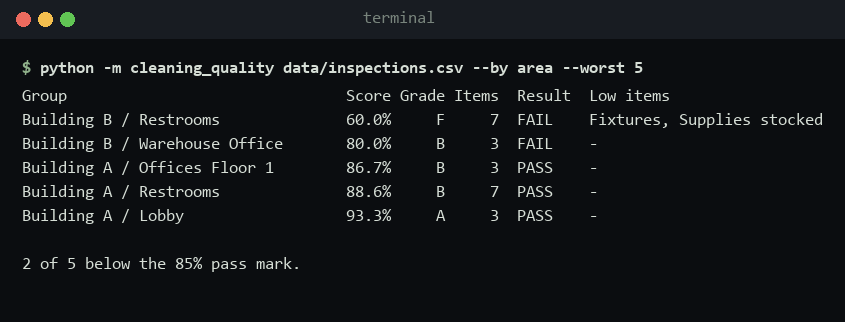

# cleaning-quality-score

[](https://github.com/yassine2med/cleaning-quality-score/actions/workflows/ci.yml)  

Turns cleaning inspection checklists into percentage scores, grades and a pass or fail per building or area.



## What it is for

Building managers and facility coordinators inspect restrooms, lobbies and offices, and need to show whether a cleaning contractor is meeting the standard. A pile of checklists is hard to compare. This tool scores each line item from 0 to 5, rolls them up to a percentage, and lists the weakest areas first, together with the specific items that scored 2 or lower. The result can be used in a monthly contractor review.

## Install

```
git clone https://github.com/yassine2med/cleaning-quality-score
cd cleaning-quality-score
python -m pip install -r requirements.txt pytest
```

## How to use

| I want to | Command |
|---|---|
| Score every building | `python -m cleaning_quality data/inspections.csv` |
| Score every building and area | `python -m cleaning_quality data/inspections.csv --by area` |
| Show only the 5 lowest groups | `python -m cleaning_quality data/inspections.csv --by area --worst 5` |
| Use only inspections from a date on | `python -m cleaning_quality data/inspections.csv --since 2026-03-09` |
| Change the pass mark (default 85) | `python -m cleaning_quality data/inspections.csv --pass-mark 90` |

Exit code is 1 when any group is below the pass mark, 0 otherwise, 2 on bad input. Run from the repo folder with `PYTHONPATH=src` set, or after `pip install -e .`. The CSV has `date,building,area,item,score` with score 0 to 5.

Example:

```
$ python -m cleaning_quality data/inspections.csv --by area --worst 5
Group                               Score Grade Items  Result  Low items
Building B / Restrooms              60.0%     F     7  FAIL    Fixtures, Supplies stocked
Building B / Warehouse Office       80.0%     B     3  FAIL    -
Building A / Offices Floor 1        86.7%     B     3  PASS    -
Building A / Restrooms              88.6%     B     7  PASS    -
Building A / Lobby                  93.3%     A     3  PASS    -

2 of 5 below the 85% pass mark.
```

## How it works

- Each group's percent is the sum of its scores divided by 5 times the number of items.
- Grades: A at 90 and up, B at 80, C at 70, otherwise F.
- Groups are sorted lowest first.
- Low items are the line items in that group that scored 2 or less.
- The pass mark is separate from the grade, so a B can still fail a strict contract.

## Limits

All items have the same weight. It does not read PDF or app checklists, only the CSV format above, and it does not compute trends over time.

MIT license. Yassine Emhamed, 2026.
